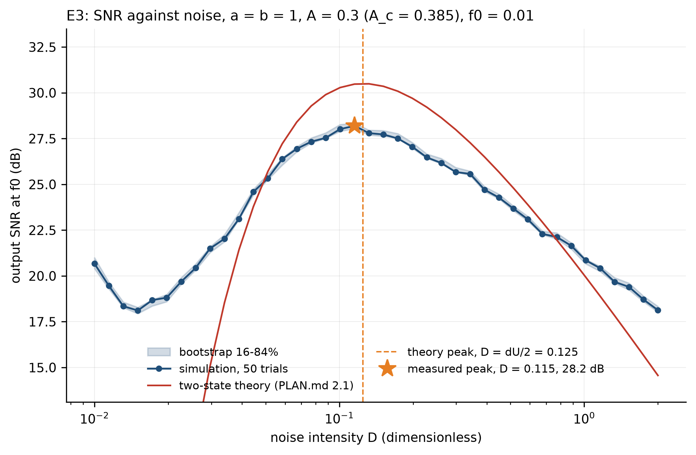
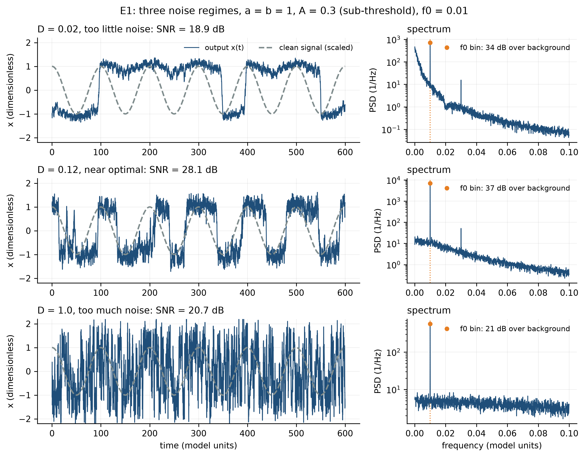
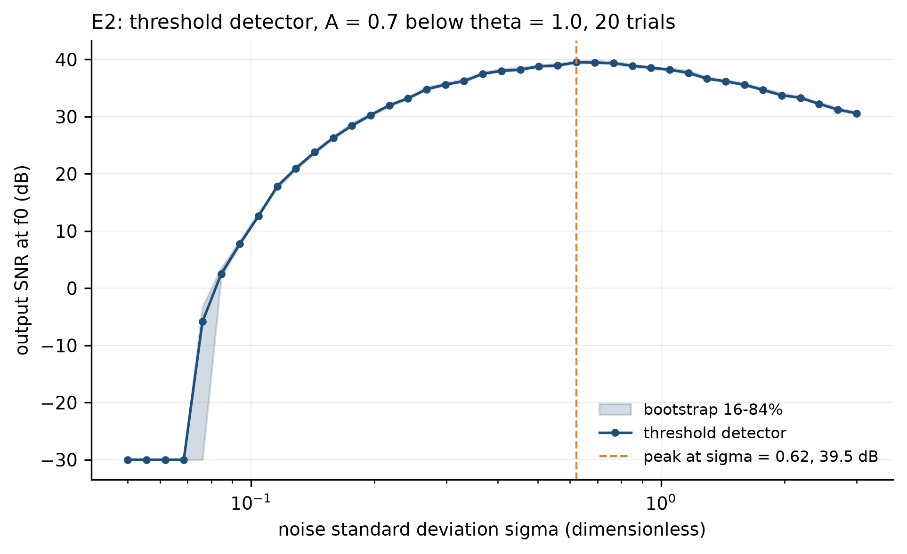
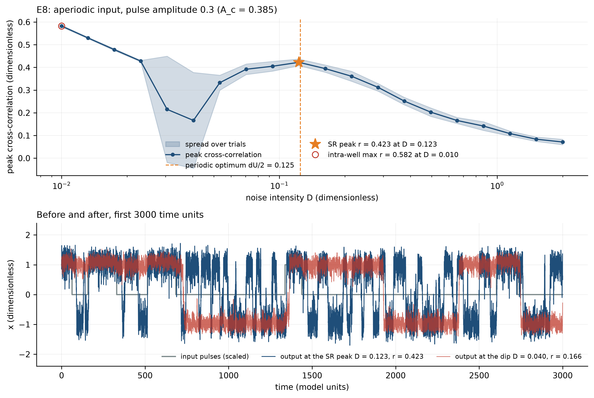
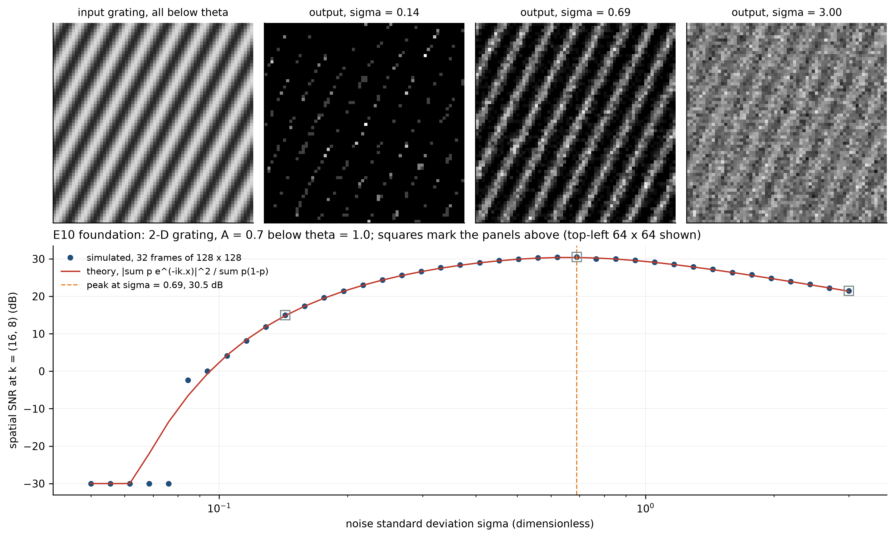
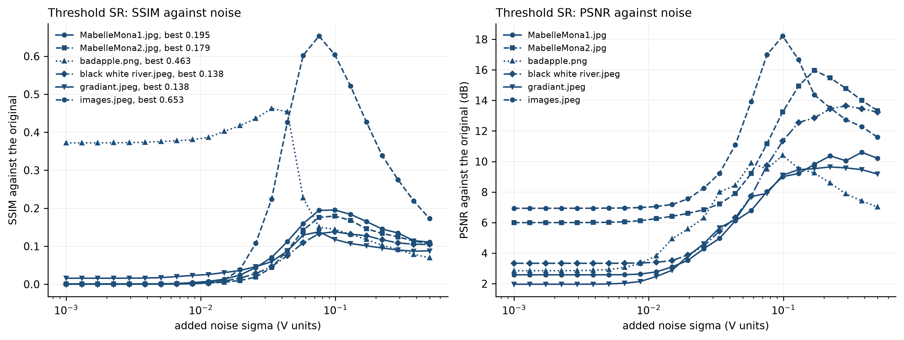
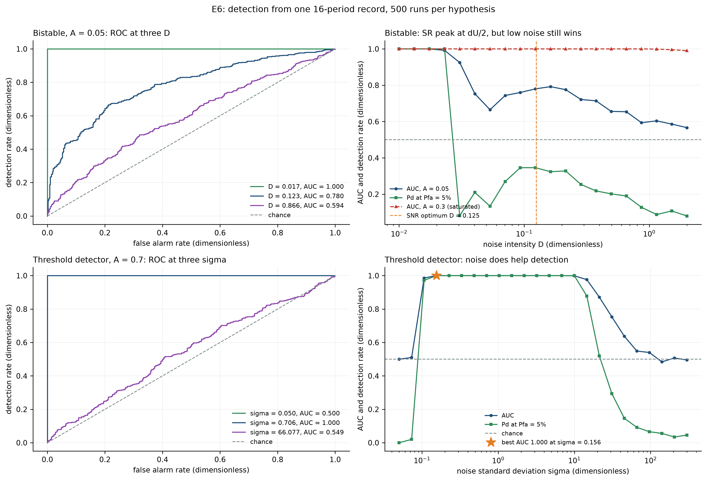
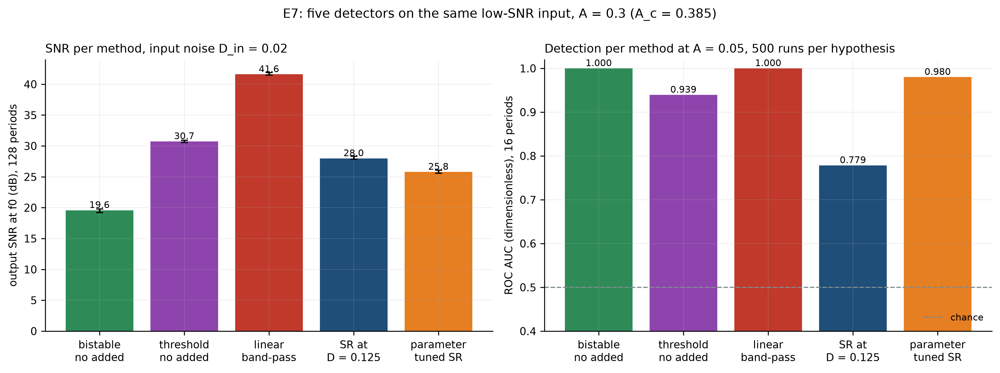

# การเสริมสัญญาณอ่อนในสภาวะ SNR ต่ำด้วยหลักการ Stochastic Resonance

**Low-SNR Signal Enhancement Using Stochastic Resonance**: รายงานผลตาม project proposal

ปัญญวัฒน์ เชื้อวัชรินทร์ (6710504077) · 01204496 Algorithmic DSP · ภาคเรียน 1/2569

รายงานนี้ครอบคลุมเฉพาะสิ่งที่ proposal สัญญาไว้: ระบบ SR สำหรับสัญญาณ 1 มิติ (งานหลัก)
และการทดสอบกับภาพแสงน้อย 2 มิติ (ส่วนขยาย) ตัวเลขทุกตัวที่เป็นตัวหนามาจาก `results/`
ผ่าน `report/extract_numbers.py` และรูปทุกรูปสร้างใหม่ได้ทั้งหมดด้วย `python make_all.py`
งานที่ทำเกินจาก proposal อยู่ใน `report/report.md`

## 1. บทนำ

สัญญาณ 1 มิติที่อ่อนกว่า threshold ของตัวตรวจจับจะมองไม่เห็นเลยถ้าตรวจตรง ๆ ปกติ noise
คือสิ่งที่ต้องกำจัด แต่ในระบบไม่เชิงเส้นที่มี threshold การเติม noise ในปริมาณที่พอดีช่วยดันสัญญาณให้ข้าม threshold ได้ ปรากฏการณ์นี้คือ stochastic resonance (SR) ที่ Benzi, Sutera
และ Vulpiani เสนอ [1] และ Gammaitoni et al. รวบรวมไว้ [3]

วัตถุประสงค์ตาม proposal มีสองข้อ:

1. พัฒนาระบบ SR สำหรับตรวจจับและเสริมสัญญาณอ่อนที่อยู่ใต้ threshold ในสภาวะ SNR ต่ำ
2. หาปริมาณ noise ที่เหมาะสมที่สุด (sweet spot) ที่ทำให้ output SNR สูงสุด

คำตอบสั้น ๆ: ทั้งสองข้อทำได้ output SNR มีจุดยอดชัดที่ **D = 0.1153** ห่างจากที่ทฤษฎีทำนาย
**7.7 %** และ noise พาตัวตรวจจับแบบ threshold จากเดาสุ่มไปถึงตรวจได้ทุกครั้ง แต่ SR ไม่ได้ดีที่สุด:
ถ้าใช้ตัวกรองเชิงเส้นได้ ตัวกรองชนะ และในภาพแสงน้อย gamma หรือ CLAHE ชนะ

## 2. วิธีการ

### 2.1 ระบบ 1 มิติ (งานหลัก)

ระบบ bistable แบบ overdamped ขับด้วย sine อ่อนกับ white noise:

    dx/dt = a x - b x^3 + A cos(2 pi f0 t) + sqrt(2 D) xi(t)

ที่ a = b = 1 กำแพงศักย์สูง **0.2500** และ amplitude ขั้นต่ำที่ข้ามได้เองคือ
**A_c = 0.3849** ใช้ **A = 0.3** คือ **0.779** ของ A_c ดังนั้นถ้าไม่มี noise อนุภาคไม่มีทางข้ามบ่อ
noise ทำให้ข้ามได้ด้วยอัตรา Kramers [6] และแบบจำลอง two-state ของ McNamara และ
Wiesenfeld [4] ทำนายว่า output SNR สูงสุดที่ **D = dU/2 = 0.1250**

แก้สมการด้วย Euler-Maruyama [7, 8] ที่ dt = 0.01 วัด output SNR จาก periodogram เฉลี่ยหลาย
trial เป็นอัตราส่วนของ bin ที่ f0 ต่อ median ของ bin รอบข้าง แล้วกวาด D 40 ค่าจาก 0.01 ถึง 2
แถบความคลาดเคลื่อนเป็น bootstrap ตรวจตัวแก้สมการซ้ำสองทาง: ลด dt ลงครึ่งหนึ่ง และเปลี่ยนเป็นวิธี Heun [8]

ตัวตรวจจับแบบ threshold (y = 1 เมื่อ s + noise > θ) เป็นระบบ SR ที่ง่ายที่สุด [9] ใช้เป็นตัวเปรียบเทียบและเป็นแกนของส่วนขยายภาพ

### 2.2 ภาพแสงน้อย 2 มิติ (ส่วนขยาย)

หลักการเดียวกันในสองมิติ ตามแนวของ Simonotto et al. [5]: ใช้เฉพาะช่องความสว่าง V ของ HSV
หรี่ภาพที่สว่างปกติลงเหลือ 12 % เติม sensor noise เล็กน้อยแล้วปัดเป็น 8 บิต ภาพต้นฉบับจึงเป็น
ground truth ได้ ตั้ง θ ที่ค่าสว่างที่สุดของภาพมืด ทุก pixel จึงอยู่ใต้ threshold เหมือนข้อ 2.1
เติม noise ขนาด σ ตัดที่ θ เฉลี่ย 50 เฟรม แล้วยืดให้เต็มช่วง จากนั้นกวาด σ 24 ค่า

เทียบกับ histogram equalization และ gamma 0.45 ตาม proposal [15] และเพิ่ม CLAHE [14]
วัดด้วย SSIM [13] และ PSNR [15] เทียบกับภาพต้นฉบับ ใช้ภาพทดสอบ 6 ภาพ [16]–[20]

### 2.3 เครื่องมือ

Python กับ NumPy, SciPy, Matplotlib, scikit-image และ OpenCV โค้ดที่ใช้ซ้ำอยู่ใน `src/srlab/`
พร้อม unit test 61 ตัว ผ่านครบ และได้ลองสร้างผลทั้งหมดใหม่ใน virtual environment ที่ติดตั้งใหม่จาก `requirements.txt`: ตัวเลขในรายงานออกมาตรงทุกตัว

## 3. ผลลัพธ์ตามที่คาดหวังใน proposal

### 3.1 กราฟ output SNR เทียบกับปริมาณ noise (ผลหลัก)

output SNR ขึ้นจาก **20.67 dB** ที่ D = 0.01 ถึงยอด **28.19 dB** ที่ **D = 0.1153**
(bootstrap **[28.04, 28.34] dB**) แล้วลงเหลือ **18.13 dB** ที่ D = 2 ยอดห่างจากที่ทำนาย 0.125
อยู่ **7.7 %** ซึ่งเล็กกว่าระยะห่างของจุดในการกวาดเอง (**14.6 %** ต่อจุด) ลด dt ครึ่งหนึ่งได้ยอดที่
**D = 0.1153** เท่าเดิม ต่างสูงสุด **0.69 dB** และวิธี Heun ก็ได้ **D = 0.1153** ต่างสูงสุด
**0.66 dB** ยอดนี้จึงมาจากระบบจริง ไม่ใช่จากตัวแก้สมการ

ยอดนี้ไม่ได้อยู่ที่เดียวตลอด: ไม่ขึ้นกับ amplitude แต่เลื่อนตามความถี่ของสัญญาณ จาก
**D = 0.0879** ที่ f0 = 0.005 ถึง **0.1986** ที่ f0 = 0.05 เพราะสัญญาณเร็วต้องการการกระโดดข้ามบ่อที่เร็วขึ้น ใช้งานจริงจึงต้องปรับ noise ตามสัญญาณ

### 3.2 สัญญาณก่อนและหลัง

ที่ D = 0.02 อนุภาคแทบไม่ข้ามบ่อ ได้ **18.88 dB** ที่ D = 0.12 มันข้ามตามจังหวะของสัญญาณ ได้
**28.11 dB** และที่ D = 1.0 ข้ามเร็วเกินจนเสียจังหวะ ได้ **20.68 dB** ภาพกลางคือ SR ในรูปเดียว

ตัวตรวจจับแบบ threshold ที่ θ = 1 กับ sine A = 0.7 ไม่ให้ output เลยที่ **4** ระดับ noise แรก
ขึ้นไปถึง **39.50 dB** ที่ **sigma = 0.621** แล้วลงเหลือ **30.58 dB** ที่ sigma = 3

proposal ระบุสัญญาณ pulse ไว้ด้วย: ใช้ pulse train แบบสุ่มใต้ threshold แทน sine วัดด้วย
correlation ระหว่าง input กับ output [10] ได้ resonance ที่ **r = 0.423** เมื่อ **D = 0.1230** ห่างจากยอดของ sine แค่ **1.6 %** SR จึงไม่ได้ขึ้นกับว่าสัญญาณเป็นคาบ

### 3.3 ภาพแสงน้อยก่อนและหลัง

ก่อนใช้ภาพจริง ทดสอบ SR ใน 2 มิติแบบที่รู้คำตอบล่วงหน้าก่อน (ขั้นพื้นฐานของ E10): ใช้ลาย sine บนระนาบ
s(x, y) = A cos(2π (kx·x + ky·y) / N) ขนาด 128 × 128 pixel ที่ A = 0.7 ต่ำกว่า θ = 1 ทุกจุด
เหมือน E2 แต่เปลี่ยนจากเวลาเป็นตำแหน่ง เติม noise ตัดทีละ pixel เฉลี่ย 32 เฟรม แล้ววัด SNR
เชิงพื้นที่ที่ความถี่ของลายด้วย 2D FFT

noise น้อยไม่มี pixel ไหนข้าม θ ได้ภาพดำ (**5** ระดับ noise แรกอยู่ที่พื้น -30 dB) noise พอดีเห็นลาย
ชัด SNR สูงสุด **30.51 dB** ที่ **sigma = 0.690** และ noise มากไปลายจมหายเหลือ **21.46 dB** ที่
sigma = 3 ผลจำลองตรงกับสูตรทางทฤษฎีของ threshold ที่ pixel เป็นอิสระต่อกัน: ยอดอยู่ที่ σ เดียวกัน
(ทฤษฎี **30.37 dB**) และต่างกันไม่เกิน **0.31 dB** ทุกจุดที่ทฤษฎีสูงกว่า 0 dB ดังนั้น SR ทำงานใน 2 มิติ
ตามทฤษฎีจริง ส่วนภาพจริงข้างล่างจึงวัดแค่ว่าใช้แล้วคุ้มไหม ไม่ใช่ว่าหลักการใช้ได้หรือไม่

ทุกภาพมี resonance: SSIM ขึ้นตาม σ จนสูงสุดที่ σ ระหว่าง **0.034 ถึง 0.099** แล้วลดลงเมื่อ noise
มากเกิน ผลของแต่ละวิธี (SSIM, ตัวหนาคือดีที่สุดของแต่ละภาพ):

| ภาพ | ภาพมืด | Hist. eq. | CLAHE | Gamma 0.45 | SR ที่ σ ดีที่สุด |
| --- | --- | --- | --- | --- | --- |
| images | 0.067 | 0.800 | **0.906** | 0.530 | 0.653 |
| badapple | **0.470** | 0.112 | 0.372 | 0.379 | 0.463 |
| MabelleMona1 | 0.185 | 0.408 | 0.520 | **0.591** | 0.195 |
| MabelleMona2 | 0.195 | 0.275 | 0.466 | **0.693** | 0.179 |
| black white river | 0.198 | 0.258 | 0.441 | **0.659** | 0.138 |
| gradiant | 0.222 | 0.303 | 0.414 | **0.593** | 0.138 |

## 4. ประเมินตามเกณฑ์ใน proposal

**เกณฑ์ 4, ด้าน SNR.** ผ่าน: output SNR มีจุดยอดชัดที่ **D = 0.1153** ตามข้อ 3.1 และอยู่ในช่วงที่ทฤษฎีทำนาย

**เกณฑ์ 5, ความสามารถในการตรวจจับ.** วัดแบบที่ตัวตรวจจับใช้จริงด้วย ROC [11]: 500 รอบต่อสมมติฐาน ตัดสินใจจากบันทึกสั้น 16 คาบ ตัวตรวจจับแบบ threshold ชัดที่สุด ถ้าไม่มี noise มันเดาสุ่ม
(AUC **0.500** โอกาสตรวจเจอ **0.000**) เติม noise แล้วได้ AUC **1.000** ที่ **sigma = 0.156**
และโอกาสตรวจเจอ **1.000** แต่ noise มากไปก็กลับไปเดาสุ่ม (AUC **0.495** ที่ **sigma = 300**)
ในระบบ bistable ที่ amplitude อ่อน A = 0.05 noise ช่วยได้เฉพาะเทียบกับจุดตก: AUC ตกถึง
**0.665** แล้วฟื้นเป็น **0.792** ใกล้ตำแหน่งที่ทำนาย

**เกณฑ์ 6, เทียบกับกรณีไม่ใช้ SR.** การเติม noise ให้ระบบ bistable ได้เพิ่ม **+8.40 dB** คือ SR
ทำงานจริง แต่ตัวกรอง band-pass เชิงเส้นบนสัญญาณดิบซึ่งเป็น matched filter ของ sine ที่รู้ความถี่ [12]
ชนะ SR ที่ดีที่สุดอีก **+13.62 dB**

**เกณฑ์ 7, ส่วนขยายภาพ.** ข้อได้เปรียบ: SR ดึงภาพที่ทุก pixel อยู่ใต้ threshold กลับมาได้จริง
ข้อจำกัด: baseline ที่ดีที่สุดชนะ SR **5 จาก 6** ภาพ SR ชนะภาพมืดที่ยังไม่แต่งแค่ **2 จาก 6** ภาพ
และวัดด้วย PSNR CLAHE ดีที่สุด **6 จาก 6** ภาพ (**17.52 ถึง 23.17 dB** เทียบกับ SR
**7.92 ถึง 16.99 dB**) เหตุผล: ผลของ SR คือ tone curve รูป sigmoid ที่มี noise จากการเฉลี่ยแค่
50 เฟรมติดมา ส่วน gamma และ CLAHE ปรับความสว่างโดยไม่มี noise ภาพเดียวที่ SR ชนะทุก
baseline คือ badapple ที่เป็นภาพขาวดำสองระดับ ซึ่ง threshold เหมาะอยู่แล้ว

## 5. สรุป

ระบบ bistable 1 มิติที่ขับด้วย sine ใต้ threshold แสดง SR ชัดเจน output SNR สูงสุดที่
**D = 0.1153** ห่างจากทฤษฎี **7.7 %** ยืนยันด้วยตัวแก้สมการสองแบบที่ต่างกันไม่เกิน
**0.7 dB** และใช้ได้กับ pulse ด้วย noise ทำให้ตัวตรวจจับแบบ threshold ไปจากเดาสุ่มถึงตรวจได้ทุกครั้งและกลับมาเดาสุ่ม จึงตอบวัตถุประสงค์ทั้งสองข้อ แต่ SR ไม่ใช่วิธีที่ดีที่สุดเมื่อมีทางเลือก:
ตัวกรองเชิงเส้นดีกว่า **13.62 dB** สำหรับ sine ที่รู้ความถี่ และในภาพแสงน้อย gamma หรือ CLAHE
ดีกว่า SR ใน 5 จาก 6 ภาพ SR มีประโยชน์จริงเมื่อ threshold เลี่ยงไม่ได้ เช่น sensor ที่ให้ค่าแค่
0 หรือ 1

## 6. ข้อจำกัดและงานต่อ

- ค่าคงที่ข้างหน้าสูตร SNR ของ two-state (pi หรือ pi/2) ยังไม่ได้ตรวจกับ [3] ถ้าใช้ pi ระดับทางทฤษฎีอยู่สูงกว่าค่าที่วัด 2.30 dB ถ้าใช้ pi/2 จะต่ำกว่า 0.70 dB ตำแหน่งยอดไม่ขึ้นกับค่านี้
- แนวทาง B ของภาพ คือ dynamic SR ของ Chouhan et al. [2] ยังไม่ได้ทำ เพราะยังเข้าถึงเปเปอร์ไม่ได้
  และไม่ต้องการเดาค่าพารามิเตอร์กับเงื่อนไขหยุดเอง
- ทดสอบกับภาพไปแล้ว 6 ภาพ มากกว่า 1 ตัวอย่างที่ proposal ตั้งไว้ แต่ทั้งหมดเป็นภาพที่หรี่ลงเอง
  ยังไม่ได้ลองกับภาพที่ถ่ายในที่มืดจริง

## อ้างอิง

1. Benzi, Sutera and Vulpiani, "The mechanism of stochastic resonance", J. Phys. A 14, L453
   (1981). https://doi.org/10.1088/0305-4470/14/11/006
2. Chouhan, Jha and Biswas, "Enhancement of dark and low-contrast images using dynamic
   stochastic resonance", IET Image Processing 7, 174 (2013).
   https://doi.org/10.1049/iet-ipr.2012.0114
3. Gammaitoni, Hanggi, Jung and Marchesoni, "Stochastic resonance", Rev. Mod. Phys. 70, 223
   (1998). https://doi.org/10.1103/RevModPhys.70.223
4. McNamara and Wiesenfeld, "Theory of stochastic resonance", Phys. Rev. A 39, 4854 (1989).
   https://doi.org/10.1103/PhysRevA.39.4854
5. Simonotto, Riani, Seife, Roberts, Twitty and Moss, "Visual perception of stochastic
   resonance", Phys. Rev. Lett. 78, 1186 (1997). https://doi.org/10.1103/PhysRevLett.78.1186
6. Kramers, "Brownian motion in a field of force and the diffusion model of chemical
   reactions", Physica 7, 284 (1940). https://doi.org/10.1016/S0031-8914(40)90098-2
7. Maruyama, "Continuous Markov processes and stochastic equations", Rend. Circ. Mat.
   Palermo 4, 48 (1955). https://doi.org/10.1007/BF02846028
8. Kloeden and Platen, Numerical Solution of Stochastic Differential Equations, Springer
   (1992). https://doi.org/10.1007/978-3-662-12616-5
9. Gammaitoni, "Stochastic resonance and the dithering effect in threshold physical
   systems", Phys. Rev. E 52, 4691 (1995). https://doi.org/10.1103/PhysRevE.52.4691
10. Collins, Chow and Imhoff, "Aperiodic stochastic resonance in excitable systems", Phys.
    Rev. E 52, R3321 (1995). https://doi.org/10.1103/PhysRevE.52.R3321
11. Fawcett, "An introduction to ROC analysis", Pattern Recognit. Lett. 27, 861 (2006).
    https://doi.org/10.1016/j.patrec.2005.10.010
12. Kay, Fundamentals of Statistical Signal Processing, Vol. II: Detection Theory, Prentice
    Hall (1998). ISBN 013504135X
13. Wang, Bovik, Sheikh and Simoncelli, "Image quality assessment: from error visibility to
    structural similarity", IEEE Trans. Image Process. 13, 600 (2004).
    https://doi.org/10.1109/TIP.2003.819861
14. Zuiderveld, "Contrast limited adaptive histogram equalization", in Graphics Gems IV, 474
    (1994). https://doi.org/10.1016/B978-0-12-336156-1.50061-6
15. Gonzalez and Woods, Digital Image Processing, 4th ed., Pearson (2018). ISBN 9780133356724
16. @Sento123450, two illustrations (`MabelleMona1.jpg`, `MabelleMona2.jpg`),
    https://x.com/Sento123450. Used with the artist's permission, given directly to the
    author, for this project only; not for redistribution and not for training any AI system.
17. Anira (あにら), "【東方】Bad Apple!! ＰＶ【影絵】", shadow-art music video, Niconico
    sm8628149, 27 October 2009, https://www.nicovideo.jp/watch/sm8628149. Song: "Bad Apple!!
    feat. nomico", Alstroemeria Records; original composition by ZUN (Team Shanghai Alice).
18. Keith Cooper, "A Black and White test image", Northlight Images (2005),
    https://www.northlight-images.co.uk/a-black-and-white-test-image/ . (c) 2012 Keith Cooper;
    free to use for non-commercial purposes.
19. Michael Reichmann, "How to Create Color Test Charts" (the Granger chart), Luminous
    Landscape, https://luminous-landscape.com/how-to-create-color-test-charts/
20. Lazur, "black and white test image", Openclipart (6 December 2016), public domain,
    https://openclipart.org/detail/267976/black-and-white-test-image

[1]–[5] คือบรรณานุกรมเดิมใน proposal ใช้เลขเดิม ภาพทดสอบ [16]–[20] ใช้เพื่อการศึกษาเท่านั้น
และไม่ได้แจกจ่ายไปพร้อมโปรเจกต์
